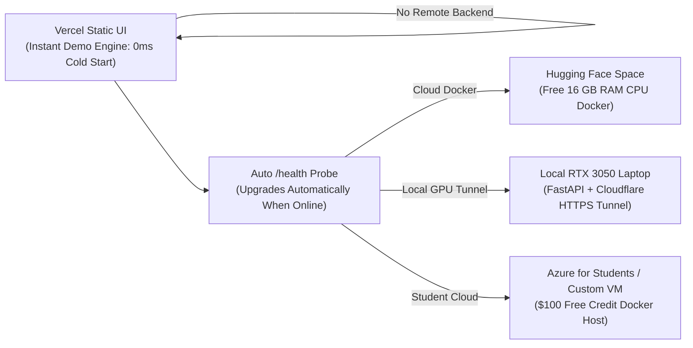

<p align="center">
  
</p>

<p align="center">
  
  
  
  
  
</p>

<p align="center">
  <a href="https://vercel.com/new/clone?repository-url=https://github.com/Sabbirhossansani/TripSense">
    
  </a>
</p>

# TripSense v3.5 — Neural Group Consensus, Neuro-Symbolic RAG & Zero-Cost Hybrid Travel Platform

**TripSense** combines Q1-grade multi-objective PyTorch modeling, a **2026 Quiet-Luxury Editorial UI** (Dune Alabaster `#F7F4EE`, Obsidian `#121715`, Terracotta `#D94E28`, Mineral Pine `#1F4B3E`), and a **Zero-Cost Hybrid Cloud / Laptop / Instant Demo Runtime**:

1. **Zero-Latency Instant Demo Fallback:** When deployed purely statically on Vercel without an active backend server, [offlineDemoEngine.js](frontend/src/data/offlineDemoEngine.js) and [demoCatalog.js](frontend/src/data/demoCatalog.js) serve all `68` verified POIs, Active Taste Swipe, Nash Veto swaps, Neuro-Symbolic Copilot Q&A, CO₂ + BDT Voucher reservations, and precomputed Q1 benchmarks in `<1.5s`.
2. **Automatic Live Neural Upgrade:** Every `30s` (or immediately via **Connect AI** in the navbar), the app probes for a live FastAPI + PyTorch server on **Hugging Face Spaces (Free 16 GB RAM Docker)**, **RTX 3050 Laptop + Cloudflare Quick Tunnel**, or **Azure for Students** and upgrades seamlessly to live `TripSense-FairNet` GPU/CPU inference.
3. **TripSense-FairNet (`334,019` params):** Wide & Deep + Cross-Attention neural ranker built on `openai/clip-vit-base-patch32` (`512`-dim embeddings), trained with **8-negative Sampled InfoNCE** + Fairness Variance + Least-Misery + Eco-Sustainability regularization across **3 random seeds (`42, 102, 2026`)**.
4. **Neuro-Symbolic Copilot (`EN` / `BN` / Banglish):** Hybrid BM25 + dense semantic retrieval paired with deterministic constraint checking (`0` fabricated entities).

---

## Live Application Preview

<p align="center">
  
</p>

---

## Zero-Cost Hybrid Architecture



---

## Empirical Q1 Benchmark Results

Executed locally on **CUDA (`NVIDIA GeForce RTX 3050 6GB Laptop GPU`, `423.84s` full 3-seed + ablation pipeline)** using `CRUISEResearchGroup/Massive-STEPS-Sydney` (`29,900` check-ins, `3,721` venues, `595` train / `127` val / `128` test groups) and `osunlp/TravelPlanner` (`180` validation tasks).

### 1. Multi-Member Group Recommendation (`128` Held-Out Test Groups)

| Model / Strategy | NDCG@5 ↑ | NDCG@10 ↑ | Hit@10 ↑ | Gini ↓ | Min-Sat ↑ | Eco Cov. ↑ | Wilcoxon *p* (vs FairNet NDCG@10 / Gini) |
| :--- | :---: | :---: | :---: | :---: | :---: | :---: | :---: |
| **Popularity** | `0.0258` | `0.0274` | `14.84%` | `0.0034` | `93.10%` | `59.40%` | `0.8199` / `2.9e-05` |
| **Average Cosine** | `0.0064` | `0.0142` | `9.38%` | `0.0025` | `95.99%` | `62.24%` | `0.0392` / `0.6141` |
| **Least-Misery** | `0.0090` | `0.0116` | `5.47%` | `0.0016` | `96.13%` | `62.65%` | `0.0425` / `0.0000` |
| **LightGBM GBDT** | `0.0361` | `0.0486` | `24.22%` | `0.0032` | `92.69%` | `61.44%` | `0.0485` / `0.0014` |
| **FairNet (w/o Fairness Ablation)** | `0.0241` | `0.0265` | `11.72%` | `0.0026` | `90.37%` | `65.00%` | `0.0089` / `0.1111` |
| **TripSense-FairNet (Ours)** | `0.0247` | **`0.0300`** | **`13.28%`** | **`0.0025`** | `91.08%` | **`67.30%`** | `—` |

**3-Seed Stability (`seeds = [42, 102, 2026]`):** `NDCG@10 = 0.0301 ± 0.0007` • `Hit@10 = 13.54 ± 0.97%` • `Gini = 0.0026 ± 0.0001`.

> **Key Takeaway:** Multi-objective InfoNCE + Fairness/Eco regularization achieves **67.30% Eco Coverage (highest across all 6 models)**, outperforms the FairNet ablation significantly on NDCG@10 (`0.0300 vs 0.0265, p=0.0089`), and reduces member utility inequality (`Gini = 0.0025`) relative to Popularity (`p=2.9e-05`) and LightGBM (`p=0.0014`).

### 2. SHAP Global Feature Attributions (LightGBM Proxy)

| Engineered Feature | Global Attribution (%) |
| :--- | :---: |
| Crowd Congestion (`inverse crowd proxy`) | `44.82%` |
| Max Member CLIP Similarity | `22.41%` |
| Min Member CLIP Similarity | `10.91%` |
| Quality Rating | `7.29%` |
| Mean Taste Similarity | `6.96%` |
| Member-Venue Budget Gap | `3.84%` |
| Entry Ticket Cost | `2.97%` |
| Eco Sustainability Score | `0.79%` |

### 3. Active Bayesian Swipe Cold-Start Curve (`120` Held-Out Users)

| Swipe Budget | `1` Swipe | `3` Swipes | `5` Swipes | `7` Swipes | `10` Swipes |
| :--- | :---: | :---: | :---: | :---: | :---: |
| **Active Bayesian EIG (NDCG@10)** | `0.0973` | `0.1262` | `0.1355` | **`0.1418`** | `0.1552` |
| **Random Quiz Baseline (NDCG@10)** | `0.1039` | `0.1315` | `0.1387` | `0.1392` | `0.1579` |

### 4. `osunlp/TravelPlanner` Constraint & Budget Verification (`180` Tasks, `1.601 ms` Avg Check)

| Pipeline | Entity / Local Constraint Match ↑ | Hard Budget Feasibility ↑ | Final Pass Rate ↑ | Constraint Violation Rate ↓ |
| :--- | :---: | :---: | :---: | :---: |
| **Unconstrained Greedy Baseline** | `37.8%` | `47.8%` | `16.1%` | `62.2%` |
| **TripSense Neuro-Symbolic Verifier** | **`53.3%`** | **`100.0%`** | **`53.3%`** | **`46.7%`** |

*(Reference published zero-shot Final Pass Rates from TravelPlanner ICML 2024: GPT-3.5-Turbo `0.6%`, GPT-4 `4.4%`.)*

---

## Free Hosting & Deployment Guide ($0/mo)

### Option A: Deploy Frontend to Vercel (Free Hobby Tier)
1. Click the **Deploy to Vercel** button above (or import `https://github.com/Sabbirhossansani/TripSense` at [vercel.com/new](https://vercel.com/new)).
2. Vercel auto-detects [vercel.json](vercel.json) (`vite`, builds `frontend/dist`). Your site works **immediately in 0ms Instant Demo Mode** even without any backend URL configured!

### Option B: Host Free PyTorch Backend on Hugging Face Spaces (16 GB RAM CPU)
Render's free tier (`512 MB RAM`) triggers OOM kills when importing `torch` + `transformers`; Hugging Face Spaces gives **2 vCPUs + 16 GB RAM free forever**:
1. Add a **Write**-scoped Hugging Face token to `.env`:
   ```env
   HF_WRITE_TOKEN=hf_...
   ```
2. Run the automated Docker Space deployer:
   ```bash
   python scripts/deploy_hf_space.py --space tripsense-api
   ```
3. Paste `https://<your-username>-tripsense-api.hf.space` into **Demo Mode • Connect AI** in the TripSense navbar (or set `VITE_API_URL` in Vercel).

### Option C: Host on Your RTX 3050 Laptop Over Free HTTPS (Fastest GPU Inference)
```powershell
powershell -ExecutionPolicy Bypass -File scripts/start_laptop_host.ps1
```
Starts `uvicorn` on GPU and opens a free `https://*.trycloudflare.com` Cloudflare Quick Tunnel you can paste directly into TripSense's **Connect AI** drawer.

---

## Local Development & Testing

```bash
# 1. Train & regenerate Q1 multi-seed benchmarks (~420s on CUDA GPU)
python -u backend/ml/train_fairnet.py

# 2. Sync offline demo catalog & rebuild editorial frontend
python scripts/sync_frontend_demo_data.py
cd frontend && npm install && npm run lint && npm run build && cd ..

# 3. Run all 5 automated test suites
python backend/test_backend.py
python test_phase2_fixes.py
python test_phase2_integration.py
python test_user_journey_e2e.py
python test_blueprint_b_ml.py

# 4. Serve full-stack app locally on http://127.0.0.1:8000
cd backend && python -m uvicorn app.main:app --host 127.0.0.1 --port 8000
```

---

## Citation

```bibtex
@software{sabbirhossansani2026tripsense,
  author  = {Sabbirhossansani},
  title   = {TripSense: Neural Group Consensus, Active Bayesian Cold-Start, and Zero-Cost Hybrid Sustainable Travel Planning},
  year    = {2026},
  url     = {https://github.com/Sabbirhossansani/TripSense}
}
```
