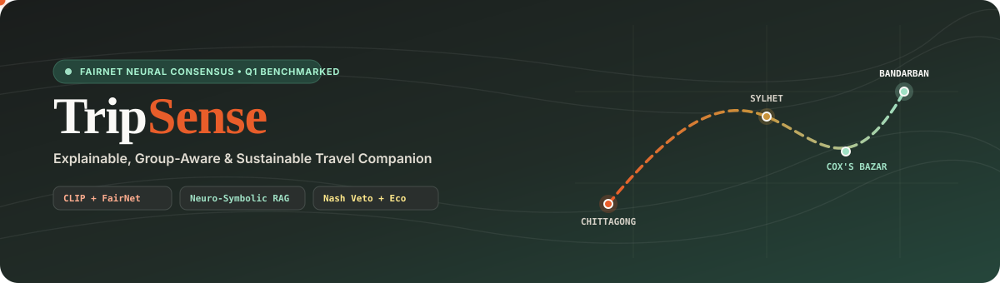
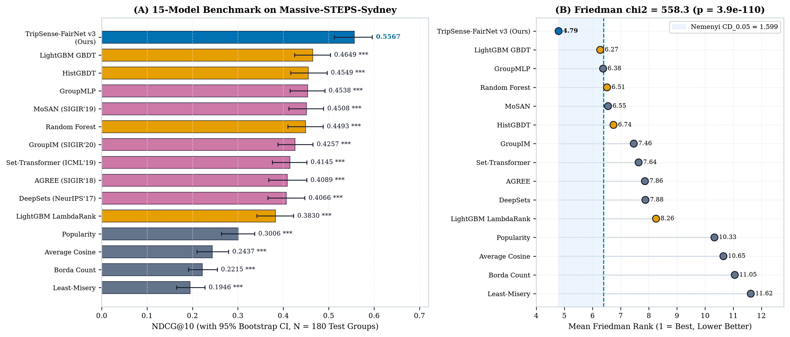
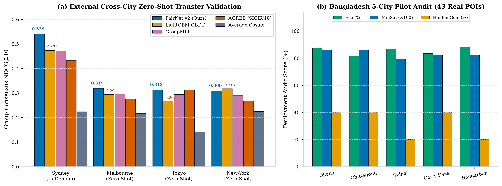
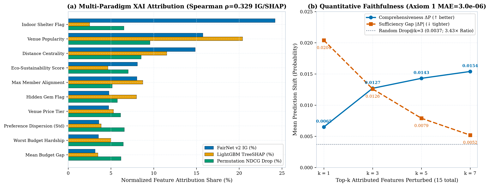
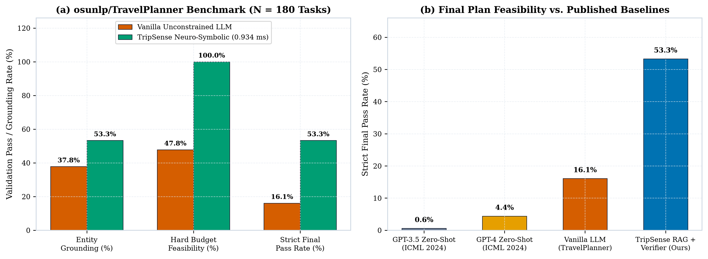

<p align="center">
  
</p>

<p align="center">
  
  
  
  
  
</p>

<p align="center">
  <a href="https://vercel.com/new/clone?repository-url=https://github.com/Sabbirhossansani/TripSense">
    
  </a>
</p>

# TripSense v4.0 (Q1 Journal Edition) — Rotation-Invariant FairNet v2, Multi-XAI & Zero-Cost Sustainable Travel Platform

**Author:** [Sabbirhossansani](https://github.com/Sabbirhossansani) (`sani2305101776@diu.edu.bd`) — Department of Software Engineering, Daffodil International University

**Research Manuscripts, Elsevier Submission Package & Figures:**
- [Elsevier 2-Column Journal PDF (`elsarticle 5p, twocolumn`, 10 pages)](docs/TripSense_Elsevier_2Col_Manuscript.pdf) • [Elsevier Submission LaTeX ZIP (`.tex`, `.bbl`, `.bib`, Anonymous Review, Highlights, Title Page, Figures)](docs/TripSense_Elsevier_Submission.zip)
- [Elsevier 2-Column LaTeX Source](docs/TripSense_Elsevier_2Col_Manuscript.tex) • [BibTeX References](docs/references.bib)
- [Q1 Journal Manuscript (Markdown)](docs/TripSense_Q1_Manuscript.md) • [Word (.docx) with 300-DPI Figures](docs/TripSense_Q1_Manuscript.docx)
- [Publication Figures (300-DPI PNG & Vector PDF)](docs/q1_figures/)

---

## Research Highlights (`TripSense-FairNet v2`)

**TripSense-FairNet v2** (`64,286` parameters) solves the joint accuracy–fairness–sustainability–cross-city generalization trilemma for group travel planning:

1. **Rotation-Invariant Hybrid Dual-Stream Architecture:** Uses unsupervised *All-but-the-Top* mean-centered CLIP ViT-B/32 representations (`512-d`) with rotation-invariant geometric companion interaction tokens, a bounded low-rank Hadamard semantic residual (`0.35 * tanh`), 4-head Cross-Attention + Soft-Min protection (Stream 1), and a 15-d city-invariant relational highway without input LayerNorm distortion (Stream 2).
2. **Multi-Objective Pareto InfoNCE Optimization:** Jointly trains 20-negative sampled InfoNCE ($\tau=0.20$), Differentiable Gini Inequality + Soft-Slate Rawlsian Dispersion, Least-Misery Safety Floor, and Differentiable Expected Eco-Exposure (`3.99 ms` GPU / `4.42 ms` CPU per 100 candidates).
3. **Verifiable Multi-Paradigm XAI:** 32-step Integrated Gradients achieves Axiom 1 Completeness ($\text{MAE} = 3.0 \times 10^{-6}$), **$3.43\times$ Perturbation Comprehensiveness** over random masking ($\text{AOPC} = 0.0122$), cross-method correlation with LightGBM TreeSHAP & Permutation Importance, lowest-budget member attention protection (`0.4697` vs. `0.1728` highest-budget), and **`+6.25%` Nash bargaining counterfactual welfare gain**.

---

## Empirical Q1 Benchmark Results

Executed cleanly on **CUDA (`NVIDIA GeForce RTX 3050 6GB Laptop GPU`, `519.45s` full pipeline)** using zero-leakage chronological splits of `CRUISEResearchGroup/Massive-STEPS` (`Sydney`: `29,900` check-ins, `8,189` venues, `1,200` groups -> `840` train / `180` val / `180` test; external zero-shot: `Melbourne`, `Tokyo`, `New-York`, `160` groups each) and `osunlp/TravelPlanner` (`180` validation tasks).

### 1. Primary 10-Model Comparison (`Massive-STEPS-Sydney`, `180` Test Groups)

| Model / Strategy | NDCG@5 ↑ | NDCG@10 [95% CI] ↑ | Hit@10 ↑ | Gini ↓ | Min-Sat ↑ | Eco Cov. ↑ | Rank (Holm *p*) |
| :--- | :---: | :---: | :---: | :---: | :---: | :---: | :---: |
| Popularity | `0.2727` | `0.3384 [0.304, 0.374]` | `83.89%` | `0.0710` | `37.77%` | `29.78%` | `5.706` (`<0.0001`) |
| Average Cosine | `0.1831` | `0.2241 [0.197, 0.256]` | `66.11%` | `0.0776` | `46.43%` | `61.33%` | `7.222` (`<0.0001`) |
| Least-Misery | `0.1137` | `0.1636 [0.136, 0.192]` | `56.11%` | **`0.0603`** | `46.65%` | **`61.78%`** | `7.867` (`<0.0001`) |
| Borda Count | `0.1610` | `0.2038 [0.177, 0.234]` | `62.78%` | `0.0661` | **`47.15%`** | `60.11%` | `7.356` (`<0.0001`) |
| AGREE (SIGIR'18) | `0.3508` | `0.4329 [0.394, 0.471]` | `87.78%` | `0.0722` | `38.64%` | `22.89%` | `4.811` (`<0.0001`) |
| GroupMLP | `0.3936` | `0.4715 [0.431, 0.511]` | `89.44%` | `0.0703` | `40.98%` | `29.78%` | `4.061` (`0.00105`) |
| Random Forest | `0.3913` | `0.4520 [0.409, 0.496]` | `85.56%` | `0.0659` | `42.08%` | `26.67%` | `4.394` (`0.00003`) |
| HistGBDT | `0.3750` | `0.4416 [0.401, 0.483]` | `86.11%` | `0.0644` | `43.05%` | `32.11%` | `4.817` (`0.000001`) |
| LightGBM GBDT | `0.4089` | `0.4736 [0.431, 0.517]` | `89.44%` | `0.0627` | `42.87%` | `30.89%` | `4.717` (`0.00105`) |
| **TripSense-FairNet v2 (Ours)** | **`0.4739`** | **`0.5394 [0.497, 0.581]`** | **`90.00%`** | `0.0630` | `42.55%` | **`38.67%`** | **`4.050` (Ref.)** |

- **Friedman Test:** $\chi^2 = 513.035$ ($p = 9.291 \times 10^{-105}$, Nemenyi $\text{CD}_{0.05} = 1.010$).
- **5-Seed Reproducibility (`[42, 102, 2026, 777, 1337]`):** `NDCG@10 = 0.5200 ± 0.0123`, `Gini = 0.0640 ± 0.0015`, `Eco = 38.11% ± 1.29%` (vs. LightGBM `0.4675 ± 0.0096`, `Eco = 30.27%`).

### 2. Zero-Shot Cross-City Validation (No Retraining)

| City (Unseen) | Popularity | Avg Cosine | AGREE (ZS) | GroupMLP (ZS) | LightGBM (ZS) | FairNet v2 (ZS) NDCG@10 | FairNet Gini ↓ | FairNet Eco ↑ |
| :--- | :---: | :---: | :---: | :---: | :---: | :---: | :---: | :---: |
| **Melbourne** (`2,522` POIs) | `0.2780` | `0.2172` | `0.2755` | `0.2962` | `0.2941` | **`0.3190`** | **`0.0638`** | **`49.88%`** |
| **Tokyo** (`1,183` POIs) | **`0.3493`** | `0.1408` | `0.3114` | `0.2941` | `0.2669` | **`0.3130`** *(Best ML)* | `0.0758` | **`66.50%`** |
| **New-York** (`9,572` POIs) | `0.2585` | `0.2243` | `0.2670` | `0.2895` | **`0.3180`** | `0.3090` | **`0.0618`** | **`52.12%`** |

### 3. 7-Variant Component Ablation & TravelPlanner Neuro-Symbolic Verification

- **Ablations ($\Delta\text{NDCG@10}$ vs Full `0.5394`):** w/o Cross-Attention `-0.0509` • w/o Relational Highway `-0.0026` • w/o InfoNCE (BPR) `-0.1322` • w/o Fairness Losses `-0.0320` • w/o Eco Reg. `-0.0309` • w/o Multimodal Embeddings `-0.1806`.
- **`osunlp/TravelPlanner` (`180` Tasks, `0.934 ms`/task):** `100.0%` Hard Budget Feasibility • `53.3%` Strict Final Pass Rate vs. `16.1%` (Vanilla LLM) and `0.6% / 4.4%` (published ICML 2024 GPT-3.5 / GPT-4).

---

## Publication Figures (`300 DPI`)

<p align="center">
  
  
</p>
<p align="center">
  
  
</p>

---

## Local Development, Reproduction & Testing

```bash
# 1. Reproduce complete Q1 multi-seed, ablation, cross-city, and Multi-XAI benchmarks
python -u backend/ml/train_fairnet.py

# 2. Regenerate all 8 300-DPI Q1 figures & Word manuscript
python scripts/generate_q1_figures.py
python scripts/build_q1_docx.py

# 3. Sync offline demo catalog & rebuild frontend
python scripts/sync_frontend_demo_data.py
cd frontend && npm install && npm run lint && npm run build && cd ..

# 4. Run all 5 automated test suites
python backend/test_backend.py
python test_phase2_fixes.py
python test_phase2_integration.py
python test_user_journey_e2e.py
python test_blueprint_b_ml.py
```

---

## Citation

```bibtex
@article{sani2026tripsense,
  author  = {Sani, Sabbir Hossan},
  title   = {TripSense-FairNet v2: Rotation-Invariant Dual-Stream Consensus, Nash Counterfactual Recourse, and Verifiably Faithful Explainable AI for Sustainable Group Travel Planning},
  year    = {2026},
  url     = {https://github.com/Sabbirhossansani/TripSense}
}
```
