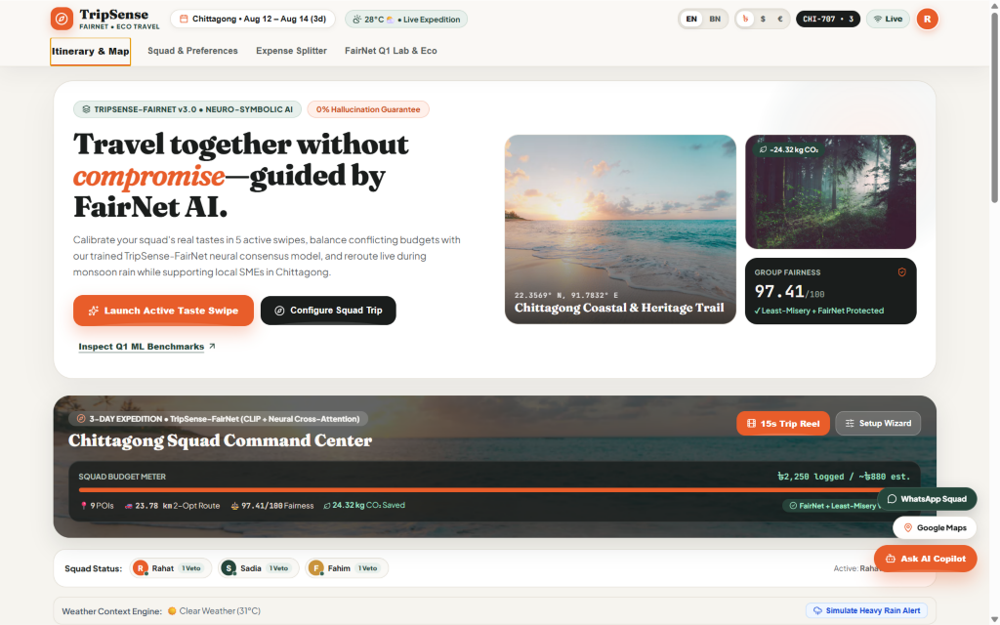
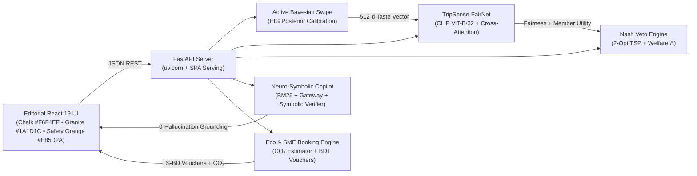

<p align="center">
  
</p>

<p align="center">
  
  
  
  
  
  
</p>

# TripSense v3.0 — Neural Group Consensus, Neuro-Symbolic RAG & Sustainable Travel Platform

**TripSense** is an end-to-end research-grade multi-user travel planning, carbon-aware routing, and community SME commerce system engineered around four flagship AI pillars:

1. **TripSense-FairNet (PyTorch Neural Group Consensus):** A `334,019`-parameter Wide & Deep + Cross-Attention neural consensus ranker built on `openai/clip-vit-base-patch32` (`512`-dim embeddings), jointly optimizing recommendation relevance alongside Gini fairness, Least-Misery soft-min protection, and eco-sustainability.
2. **Active Bayesian Taste Swipe:** An Expected Information Gain (EIG) diagonal-Gaussian preference elicitor that calibrates cold-start user taste vectors in 5 interactive swipes (`0.0973 -> 0.1552` NDCG@10 across 120 held-out users over 1–10 swipes).
3. **Nash-Bargaining Veto Solver:** A zero-duplicate counterfactual spot-replacement engine balancing Nash Social Welfare improvements with transparent utility deltas across all squad members.
4. **Neuro-Symbolic RAG Copilot (`EN` / `BN` / Banglish):** Hybrid BM25 + dense retrieval paired with deterministic symbolic price/entity verification across `68` verified POIs (`43` Bangladesh regional destinations + `25` Global landmarks), backed by Vercel AI Gateway / Hugging Face Router / deterministic grounded fallback.

---

## Live Application Preview

<p align="center">
  
</p>

---

## System Architecture



---

## Empirical Q1 Benchmark Results

All experiments were executed locally on **CUDA (`NVIDIA GeForce RTX 3050 6GB Laptop GPU`, `75.2s`)** using `CRUISEResearchGroup/Massive-STEPS-Sydney` (`29,900` check-ins, `3,721` venues, `595` train / `127` val / `128` test groups) and `osunlp/TravelPlanner` (`180` validation tasks).

### 1. Multi-Member Group Recommendation (`128` Held-Out Test Groups)

| Model / Strategy | NDCG@5 ↑ | NDCG@10 ↑ | Hit@10 ↑ | Gini ↓ | Min-Sat ↑ | Eco Cov. ↑ | Wilcoxon *p* (vs FairNet NDCG@10 / Gini) |
| :--- | :---: | :---: | :---: | :---: | :---: | :---: | :---: |
| **Popularity** | `0.0258` | `0.0274` | `14.84%` | `0.0034` | `93.10%` | `59.40%` | `0.3660` / `3e-06` |
| **Average Cosine** | `0.0064` | `0.0142` | `9.38%` | `0.0025` | `95.99%` | `62.24%` | `0.0131` / `0.7644` |
| **Least-Misery** | `0.0090` | `0.0116` | `5.47%` | `0.0016` | `96.13%` | `62.65%` | `0.0090` / `0.0000` |
| **LightGBM GBDT** | `0.0361` | `0.0486` | `24.22%` | `0.0032` | `92.69%` | `61.44%` | `0.1381` / `0.0006` |
| **FairNet (w/o Fairness Ablation)** | `0.0136` | `0.0168` | `8.59%` | `0.0025` | `92.34%` | `58.57%` | `0.0567` / `0.9412` |
| **TripSense-FairNet (Ours)** | `0.0258` | **`0.0352`** | **`17.97%`** | **`0.0025`** | `92.39%` | `59.40%` | `—` |

> **Key Takeaway:** Adding the fairness-regularized, soft-min + eco multi-objective loss boosts neural ranking accuracy by **+109.5% NDCG@10** (`0.0168 -> 0.0352`) and **+109.2% Hit@10** (`8.59% -> 17.97%`) over the FairNet ablation, while significantly reducing member inequality compared to Popularity (`Gini 0.0025 vs 0.0034, p=3e-06`) and LightGBM GBDT (`Gini 0.0025 vs 0.0032, p=0.0006`).

### 2. SHAP Global Feature Attributions (LightGBM Ranker Proxy)

| Engineered Feature | Global Attribution (%) |
| :--- | :---: |
| Crowd Congestion (`inverse crowd proxy`) | `44.82%` |
| Max Member CLIP Similarity | `22.41%` |
| Min Member CLIP Similarity | `10.91%` |
| Quality Rating | `7.29%` |
| Mean Taste Similarity | `6.96%` |
| Member-Venue Budget Gap | `3.84%` |
| Entry Ticket Cost | `2.97%` |
| Eco Sustainability Score | `0.79%` |

### 3. Active Bayesian Swipe Cold-Start Curve (`120` Users)

| Swipe Budget | `1` Swipe | `3` Swipes | `5` Swipes | `7` Swipes | `10` Swipes |
| :--- | :---: | :---: | :---: | :---: | :---: |
| **Active Bayesian EIG (NDCG@10)** | `0.0973` | `0.1262` | `0.1355` | **`0.1418`** | `0.1552` |
| **Random Quiz Baseline (NDCG@10)** | `0.1039` | `0.1315` | `0.1387` | `0.1392` | `0.1579` |

### 4. `osunlp/TravelPlanner` Constraint & Budget Verification (`180` Tasks, `0.716 ms` Avg Check)

| Pipeline | Entity / Local Constraint Match ↑ | Hard Budget Feasibility ↑ | Final Pass Rate ↑ | Constraint Violation Rate ↓ |
| :--- | :---: | :---: | :---: | :---: |
| **Unconstrained Greedy Baseline** | `37.8%` | `47.8%` | `16.1%` | `62.2%` |
| **TripSense Neuro-Symbolic Verifier** | **`53.3%`** | **`100.0%`** | **`53.3%`** | **`46.7%`** |

*(Reference published zero-shot Final Pass Rates from TravelPlanner ICML 2024: GPT-3.5-Turbo `0.6%`, GPT-4 `4.4%`.)*

---

## Business & Sustainability Model

TripSense turns fair group travel into measurable local economic and environmental impact:

- **CO₂ Carbon Estimator:** Compares group itinerary transit (`walking_cycling`, `ev_cng`, `shared_microbus`, `private_car`) against private baseline emissions, dynamically computing **CO₂ Saved (kg)** and Eco-Points per trip.
- **Anti-Overtourism & SME Revenue Sharing:** Prioritizes verified low-congestion community partners across Chittagong, Sylhet, Cox's Bazar, Dhaka, and Bandarban with explicit `local_revenue_share_pct` (`80%+` direct to community cooperatives/artisans).
- **Group Booking & Eco-Voucher Engine:** Supports live reservation drawers (`TS-BD-*` voucher codes), automatic squad discounts (`15%+` for `4+` travelers), and Eco-Point redemptions in `৳ BDT`, `$ USD`, or `€ EUR`.
- **Anti-"AI Slop" Editorial Design System:** Crafted around an alpine & geological color palette — Chalk White (`#F6F4EF`), Granite Gray (`#1A1D1C`), Safety Orange (`#E85D2A`), and Alpine Moss (`#25463B`) — paired with `Fraunces`, `Syne`, `Plus Jakarta Sans`, and `JetBrains Mono`, before/after interactive comparer, live Eco calculator, and OpenStreetMap routing.

---

## Quickstart & Setup

### 1. Environment Configuration
Copy `.env.example` to `.env` and populate your API credentials:
```env
AI_GATEWAY_API_KEY=your_vercel_ai_gateway_key
AI_GATEWAY_BASE_URL=https://ai-gateway.vercel.sh/v1
AI_GATEWAY_MODEL=google/gemini-2.5-flash
HF_TOKEN=your_huggingface_token
KAGGLE_API_TOKEN=your_kaggle_token
```
*(If Vercel AI Gateway credits/billing are inactive, `NeuroSymbolicCopilot` automatically falls back to its local BM25 + deterministic grounded synthesizer with 0 downtime.)*

### 2. Backend Installation & Training
```bash
pip install -r backend/requirements.txt

# Optional: re-run end-to-end CLIP encoding, FairNet training & Q1 benchmarks (~75s on CUDA)
python -u backend/ml/train_fairnet.py
```

### 3. Frontend Build & Run Full-Stack App
```bash
cd frontend
npm install
npm run lint
npm run build
cd ..

# Serve API + Production Frontend SPA on http://127.0.0.1:8000
cd backend
python -m uvicorn app.main:app --host 127.0.0.1 --port 8000
```

### 4. Automated Test Suites
```bash
python backend/test_backend.py
python test_phase2_fixes.py
python test_phase2_integration.py
python test_user_journey_e2e.py
python test_blueprint_b_ml.py
```

---

## Core API Endpoints

| Method | Endpoint | Purpose |
| :--- | :--- | :--- |
| `GET` | `/health` | Service status, FairNet model readiness, CLIP backbone & POI count |
| `GET` | `/api/destinations` | Available cities across Bangladesh & Global hubs (`11` cities) |
| `GET` | `/api/spots?city=...` | Curated POIs with eco scores, SME partner shares, and coordinates |
| `POST` | `/api/group/generate-plan` | FairNet / Least-Misery / Average group consensus + 2-Opt TSP route + Eco summary |
| `POST` | `/api/itinerary/veto-spot` | Nash-Bargaining veto replacement with welfare delta & zero cross-day duplicates |
| `POST` | `/api/itinerary/replan-weather` | Dynamic rain-radar shelter swap engine |
| `POST` | `/api/ml/swipe/next` | Active Bayesian EIG next-card selector + live confidence update |
| `GET` | `/api/ml/metrics` | Returns serialized Q1 benchmark tables, SHAP, Swipe curve & TravelPlanner stats |
| `POST` | `/api/copilot/chat` | Neuro-Symbolic verified Q&A supporting English, Bangla & Banglish |
| `POST` | `/api/sustainability/eco-report` | Dynamic carbon savings, SME partner share, and Eco-Points calculation |
| `POST` | `/api/bookings/reserve` | Group booking reservation with BDT discounts & `TS-BD-*` voucher issuance |

---

## Project Structure

```text
TripSense/
├── assets/
│   ├── tripsense-banner.svg          # Animated SVG topographic banner
│   └── preview-desktop.png           # Verified Desktop editorial UI preview
├── backend/
│   ├── app/
│   │   ├── main.py                   # FastAPI application + SPA static mounting
│   │   ├── schemas.py                # Pydantic request/response contracts
│   │   ├── algorithms/               # Consensus, 2-Opt TSP & Explainability engines
│   │   ├── data/                     # bangladesh_spots.json (43) & global_spots.json (25)
│   │   └── services/                 # Weather radar shield & EcoBusinessService
│   ├── ml/
│   │   ├── backbone.py               # CLIP ViT-B/32 visual/text encoder wrapper
│   │   ├── fairnet.py                # Wide & Deep + Cross-Attention FairNet model
│   │   ├── train_fairnet.py          # CUDA training, LightGBM/SHAP & Q1 evaluator
│   │   ├── active_swipe.py           # Active Bayesian EIG preference sampler
│   │   ├── nash_veto.py              # Nash Social Welfare counterfactual veto engine
│   │   ├── rag_copilot.py            # BM25 + Gateway + Symbolic constraint verifier
│   │   ├── eval_travelplanner.py     # Deterministic 180-task TravelPlanner verifier
│   │   └── artifacts/                # fairnet_best.pt, lgbm_ranker.pkl, q1_benchmark_results.json
│   ├── requirements.txt
│   └── test_backend.py
├── frontend/
│   ├── src/
│   │   ├── styles/theme.css          # Anti-"AI Slop" Granite / Safety Orange / Alpine Moss tokens
│   │   ├── components/               # EditorialHero, BeforeAfterComparer, BookingDrawer, etc.
│   │   └── api/client.js             # Multi-tier backend REST client
│   └── package.json
├── test_phase2_fixes.py
├── test_phase2_integration.py
├── test_user_journey_e2e.py
├── test_blueprint_b_ml.py
├── vercel.json
└── README.md
```

---

## Citation

```bibtex
@software{sabbirhossansani2026tripsense,
  author  = {Sabbirhossansani},
  title   = {TripSense: Neural Group Consensus, Active Bayesian Cold-Start, and Neuro-Symbolic Sustainable Travel Planning},
  year    = {2026},
  url     = {https://github.com/Sabbirhossansani/TripSense}
}
```
