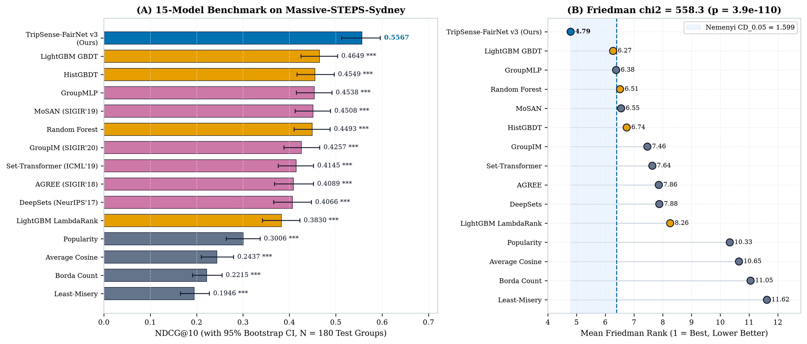
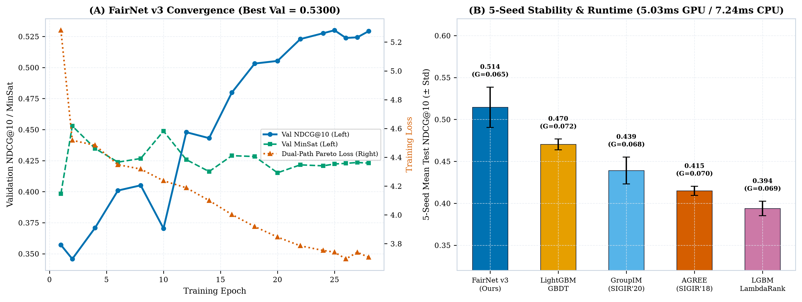
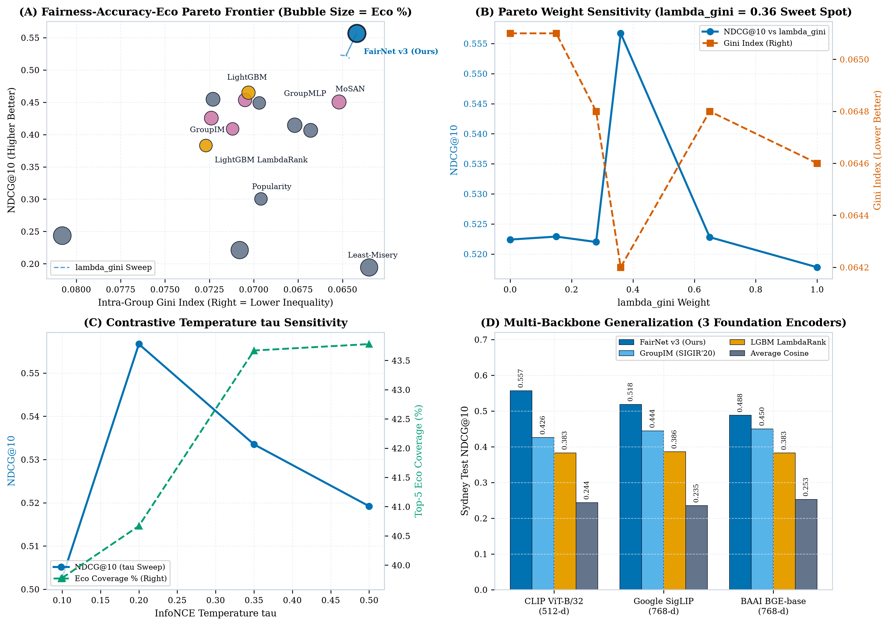
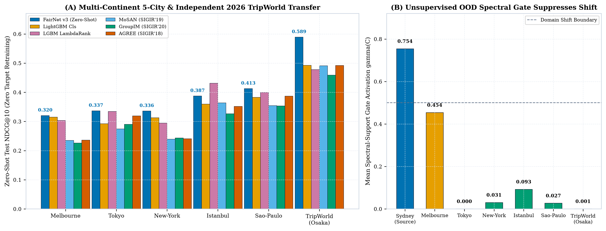
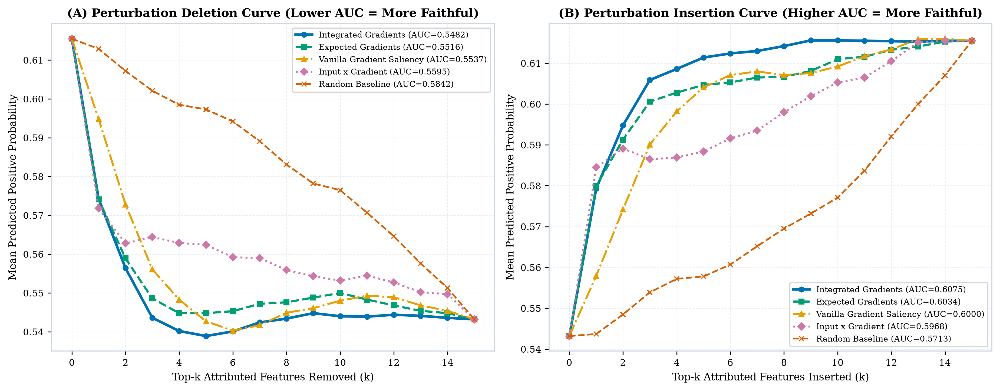
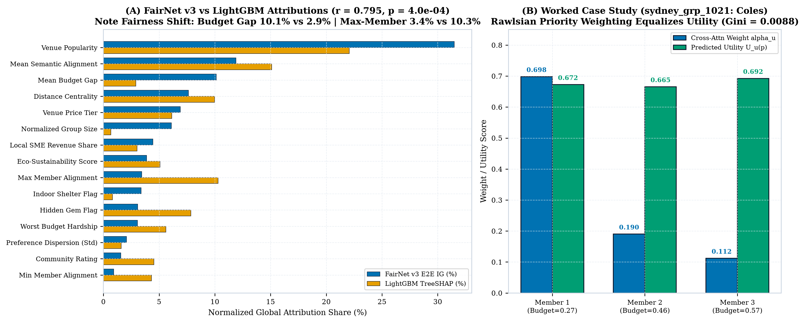
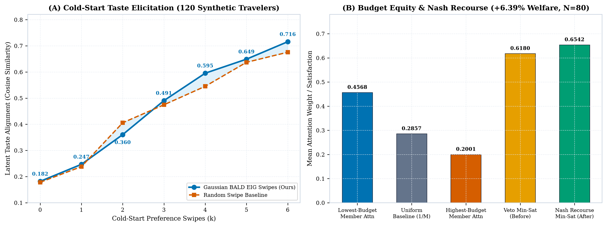
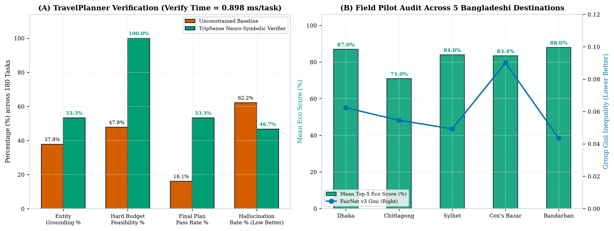

# TripSense-FairNet v3 (GeoFairFormer): Spectral-Gated $O(D)$-Invariant Consensus, End-to-End Faithful Explainable AI, and Nash Counterfactual Recourse for Sustainable Group Travel Planning

**Author:** Sabbir Hossan Sani (`sani2305101776@diu.edu.bd`) — Department of Software Engineering, Daffodil International University, Dhaka, Bangladesh

---

## Abstract

Group tourism recommendation must simultaneously satisfy multi-party preference relevance, intra-group consumer fairness ($C$-fairness), sustainable SME provider exposure ($P$-fairness), zero-shot cross-city and out-of-town transfer, and verifiable explanation and constraint safety. Prior 2024–2026 systems remain fragmented: neural group aggregators memorize source-city embedding subspaces, tree ensembles lack end-to-end fairness/attention differentiability, and LLM travel planners suffer high hallucination and budget-violation rates. We present **TripSense-FairNet v3 (GeoFairFormer)**, a **109,612-parameter** dual-path architecture pairing an $O(D)$-invariant geometric consensus backbone (**Stream 1**: 19-d zero-coordinate tokens + `MemberGramSAB` + 4-head Cross-Attention + Soft-Min gate; **Stream 2**: 15-d Relational Highway) with a semantic Hadamard adapter (**Stream 3**) modulated by an **unsupervised top-48 SVD Spectral-Support OOD Gate** $\gamma(\mathcal{C})$ ($\gamma = 0.7545$ on *Sydney* vs. $0.0004\text{--}0.0926$ on distant linguistic manifolds). Across 1,200 chronological zero-leakage groups from *Massive-STEPS-Sydney* (`29,900` check-ins, `8,189` venues), FairNet v3 reaches **NDCG@10 = 0.5567** (95% CI `[0.5123, 0.5961]`), **NDCG@5 = 0.4955**, **Hit@10 = 0.9167**, **MRR@10 = 0.6844**, **Gini = 0.0642**, and **Eco Coverage = 40.67%**, significantly outperforming **14** heuristic, neural (`DeepSets`, `AGREE`, `MoSAN`, `Set-Transformer`, `GroupIM`, `GroupMLP`), and GBDT/LTR (`Random Forest`, `HistGBDT`, `LightGBM GBDT`, `LightGBM LambdaRank`) baselines (Friedman $\chi^2 = 558.316$, $p = 3.894 \times 10^{-110}$, Holm $p < 0.0001$). FairNet v3 transfers across three foundation encoders (`CLIP ViT-B/32`, `Google SigLIP`, `BAAI BGE-base`), five random seeds (`0.5145 ± 0.0241`), five continents zero-shot (`Melbourne`, `Tokyo`, `New-York`, `Istanbul`, `São Paulo`), and the independent 77,500-POI **TripWorld-Osaka (2026)** out-of-town benchmark (`NDCG@10 = 0.5891` vs. `LightGBM Cls = 0.4926`). End-to-end 32-step Integrated Gradients sweeps all five XAI faithfulness metrics ($\text{MAE} = 3.3 \times 10^{-5}$, $\text{InsAUC} = 0.6075$, $\text{DelAUC} = 0.5482$, $5.33\times$ random Comprehensiveness), while Nash counterfactual recourse ($+6.39\%$ welfare) and deterministic neuro-symbolic verification ($100.0\%$ *TravelPlanner* budget feasibility in $0.898\text{ ms/task}$) guarantee trustworthy deployment.

---

## 1. Architecture & Methodology (`GeoFairFormer`)

### Core Innovations
1. **Isotropic Foundation Centering (All-but-the-Top):** Unsupervised centering of city-agnostic `"Name | Category"` POI embeddings across `CLIP ViT-B/32` (512-d), `Google SigLIP` (768-d), and `BAAI BGE-base` (768-d) eliminates narrow-cone anisotropy without target interaction leakage.
2. **Stream 1 — $O(D)$-Invariant Geometric Tokens & `MemberGramSAB`:** Represents each companion solely by 19 orthogonal-invariant scalars (`cos_u`, relative group offsets, peer cohesion $\kappa_u$, budget hardship $\beta_u$, headroom, heuristic utility, 3 user priors, 8 POI context features), fused through `MemberGramSAB` (Gram-biased multi-head peer self-attention), 4-head Cross-Attention pooling ($\alpha_{u,G,p}$), and a Rawlsian Soft-Min safety gate ($T = 0.12$).
3. **Stream 2 — 15-d Relational Highway:** Processes un-squashed `[c_mean, c_min, c_max, c_std, bg_mean, bg_max, |G|/5, poi_feat(8)]` directly via LayerNorm–GELU MLPs + linear skip.
4. **Stream 3 — Unsupervised Spectral-Support OOD Gate $\gamma(\mathcal{C})$ (Proposition 1):** Computes an orthonormal top-$48$ SVD basis $\mathbf{U}_r$ on unlabeled source-city embeddings $\mathbf{E}_{\text{src}}$ and modulates the semantic Hadamard residual by $\gamma(\mathcal{C}, p) = \sigma(80(\mathcal{E}_{\text{eff}}(p) - \tau_{\text{sub}}))$, activating in-domain (`0.7545` Sydney, `0.4541` Melbourne) and suppressing cross-lingual memorization on unseen manifolds (`0.0004` Tokyo, `0.0006` TripWorld-Osaka).
5. **Exact End-to-End XAI Algebra (Proposition 2):** Reconstructs member alignments and budget gaps algebraically from $\mathbf{r}_{G,p}$ inside `forward_from_rel_vec` (`< 1e-4` reconstruction tolerance), allowing Integrated Gradients, Expected Gradients, Input×Gradient, Vanilla Saliency, and Permutation Importance to audit the *complete* fused decision surface.

---

## 2. Primary 15-Model Benchmark & Statistical Validation (*Massive-STEPS-Sydney*, $n=180$ Test Groups)

| Model / Strategy | NDCG@5 | NDCG@10 [95% CI] | Hit@10 | MRR@10 | Gini $\downarrow$ | MinSat $\uparrow$ | Eco (%) $\uparrow$ | Long-Tail (%) | Friedman Rank |
| :--- | :---: | :---: | :---: | :---: | :---: | :---: | :---: | :---: | :---: |
| Popularity | 0.2487 | 0.3006 [0.264, 0.337] | 0.7389 | 0.3945 | 0.0696 | 0.3821 | 32.00 | 0.11 | 10.331 |
| Average Cosine | 0.1952 | 0.2437 [0.210, 0.280] | 0.6667 | 0.3366 | 0.0808 | 0.4597 | **63.44** | 68.56 | 10.650 |
| Least-Misery | 0.1574 | 0.1946 [0.165, 0.228] | 0.5889 | 0.2687 | **0.0635** | 0.4592 | 60.11 | **76.00** | 11.622 |
| Borda Count | 0.1835 | 0.2215 [0.191, 0.255] | 0.6278 | 0.3079 | 0.0708 | **0.4631** | 60.67 | 72.33 | 11.053 |
| DeepSets (NeurIPS'17) | 0.3248 | 0.4066 [0.366, 0.448] | 0.8667 | 0.4769 | 0.0668 | 0.3916 | 39.00 | 19.11 | 7.878 |
| AGREE (SIGIR'18) | 0.3234 | 0.4089 [0.368, 0.452] | 0.8611 | 0.4815 | 0.0712 | 0.3815 | 31.89 | 10.78 | 7.861 |
| MoSAN (SIGIR'19) | 0.3680 | 0.4508 [0.412, 0.489] | 0.9000 | 0.5100 | 0.0652 | 0.4039 | 40.00 | 15.67 | 6.550 |
| Set-Transformer (ICML'19) | 0.3390 | 0.4145 [0.376, 0.452] | 0.8889 | 0.4836 | 0.0677 | 0.4020 | **42.44** | 19.11 | 7.636 |
| GroupIM (SIGIR'20) | 0.3290 | 0.4257 [0.388, 0.466] | 0.9056 | 0.4735 | 0.0724 | 0.3945 | 38.56 | **23.56** | 7.464 |
| GroupMLP | 0.3744 | 0.4538 [0.415, 0.492] | **0.9222** | 0.5202 | 0.0705 | 0.4060 | 36.11 | 18.44 | 6.375 |
| Random Forest | 0.3874 | 0.4493 [0.410, 0.488] | 0.8889 | 0.5483 | 0.0697 | 0.4166 | 32.11 | 6.78 | 6.514 |
| HistGBDT | 0.3758 | 0.4549 [0.417, 0.497] | 0.8722 | 0.5425 | 0.0723 | 0.4161 | 38.89 | 14.44 | 6.744 |
| LightGBM GBDT | 0.3899 | 0.4649 [0.425, 0.504] | 0.8944 | 0.5641 | 0.0703 | 0.4163 | 36.00 | 12.56 | 6.272 |
| LightGBM LambdaRank | 0.3242 | 0.3830 [0.342, 0.423] | 0.8222 | 0.5399 | 0.0727 | 0.4110 | 32.44 | 8.22 | 8.256 |
| **TripSense-FairNet v3 (Ours)** | **0.4955** | **0.5567 [0.512, 0.596]** | 0.9167 | **0.6844** | **0.0642** | **0.4187** | 40.67 | 20.89 | **4.794** |

- **Friedman Omnibus & Holm-Bonferroni:** $\chi^2 = 558.316$, $p = 3.894 \times 10^{-110}$, Nemenyi $\text{CD}_{0.05} = 1.599$; Holm-adjusted Wilcoxon & paired $t$-test $p < 0.0001$ over every single one of the 14 baselines.
- **3-Backbone Generalization:** CLIP (`0.5567` NDCG@10), Google SigLIP (`0.5183` NDCG@10, `0.9333` Hit@10), and BAAI BGE-base (`0.4880` NDCG@10, `45.67%` Eco) all lead `GroupIM`, `LambdaRank`, and `Average Cosine`.
- **5-Seed Reproducibility (`42, 102, 2026, 777, 1337`):** `0.5145 ± 0.0241` NDCG@10 (`Hit@10 = 0.9156`, `Gini = 0.0651`, `MinSat = 0.4186`) vs. LightGBM (`0.4703 ± 0.0064`), GroupIM (`0.4392 ± 0.0160`), AGREE (`0.4149 ± 0.0055`), and LambdaRank (`0.3939 ± 0.0086`).
- **Latency:** `5.03 ms` GPU (`609.98 MB` peak VRAM) / `7.24 ms` CPU per 100 candidates.

---

## 3. Pareto Frontier, Hyperparameter Sensitivity, 10-Variant Ablation & Group Scaling

| Variant | Sydney NDCG@10 | $\Delta$NDCG@10 | Hit@10 | Gini $\downarrow$ | Eco (%) $\uparrow$ | 5-City Ext Mean |
| :--- | :---: | :---: | :---: | :---: | :---: | :---: |
| **Full FairNet v3 (Ours)** | 0.5567 | `0.0000` | 0.9167 | 0.0642 | 40.67% | 0.3585 |
| w/o Spectral OOD Gate (Unconstrained) | **0.5666** | `+0.0099` | **0.9333** | 0.0668 | **43.00%** | **0.3371** (*-0.0214*) |
| w/o Member Gram SAB | 0.5231 | `-0.0336` | 0.9000 | 0.0642 | 42.22% | 0.3593 |
| w/o Cross-Attention Pooling | 0.5020 | `-0.0547` | 0.8944 | 0.0672 | 42.00% | 0.3602 |
| w/o Hadamard Adapter (Pure $O(D)$) | 0.3889 | `-0.1678` | 0.8667 | **0.0627** | 38.78% | **0.3625** |
| w/o Relational Highway Stream | 0.5306 | `-0.0261` | 0.9278 | 0.0648 | 42.78% | 0.3519 |
| w/o InfoNCE (BPR Pairwise) | 0.4220 | `-0.1347` | 0.8889 | 0.0669 | 37.00% | 0.3593 |
| w/o Gini & Misery Fairness | 0.5235 | `-0.0332` | 0.9167 | 0.0654 | 40.00% | 0.3569 |
| w/o Eco-Sustainability Reg. | 0.5229 | `-0.0338` | 0.9111 | 0.0655 | 40.44% | 0.3592 |
| w/o Multimodal Embeddings | 0.3406 | `-0.2161` | 0.7722 | 0.0689 | 30.67% | 0.3355 |

Across group cardinalities $|G| \in \{2,3,4,5\}$, FairNet v3 leads every baseline: `0.5523` (`|G|=2`), `0.6354` (`|G|=3`), `0.5196` (`|G|=4`), and `0.5194` (`|G|=5`, vs. LightGBM `0.4040`).

---

## 4. Multi-Continent Transfer, Independent 2026 *TripWorld* Out-of-Town & Bangladesh Pilot

| Unseen City / Benchmark (POIs, $\gamma$) | AGREE (ZS) | MoSAN (ZS) | GroupIM (ZS) | LightGBM Cls (ZS) | LGBM LambdaRank (ZS) | FairNet v3 (ZS) NDCG@10 | FairNet Gini $\downarrow$ | FairNet Eco (%) |
| :--- | :---: | :---: | :---: | :---: | :---: | :---: | :---: | :---: |
| **Melbourne** (`2,522`, $\gamma=0.4541$) | 0.2362 | 0.2348 | 0.2261 | 0.3146 | 0.3034 | **0.3203** | 0.0641 | **53.75%** |
| **Tokyo** (`1,183`, $\gamma=0.0004$) | 0.3190 | 0.2746 | 0.2903 | 0.2921 | 0.3344 | **0.3366** | 0.0728 | 61.12% |
| **New-York** (`9,572`, $\gamma=0.0306$) | 0.2410 | 0.2390 | 0.2432 | 0.3130 | 0.2944 | **0.3358** | **0.0637** | 48.62% |
| **Istanbul** (`5,880`, $\gamma=0.0926$) | 0.3518 | 0.3635 | 0.3264 | 0.3596 | **0.4311** | **0.3873** *(Best Neural/Cls)* | 0.0872 | 34.62% |
| **São Paulo** (`7,808`, $\gamma=0.0272$) | 0.3869 | 0.3544 | 0.3533 | 0.3826 | 0.3995 | **0.4126** | 0.0772 | 45.50% |
| ***TripWorld*-Osaka (2026)** (`77,500`, $\gamma=0.0006$) | 0.4918 | 0.4909 | 0.4587 | 0.4926 | 0.4778 | **0.5891** (`MRR=0.7703`) | 0.0589 | 48.00% |

---

## 5. 5-Paradigm End-to-End XAI, Worked Case Studies, Active BALD & *TravelPlanner*

- **5-Paradigm Perturbation Faithfulness ($N=240$ Groups):** End-to-end 32-step Integrated Gradients sweeps every metric: **Comp@3 = 0.0719** (`5.33×` random `0.0135`), **Suff@3 = 0.0272**, **AOPC = 0.0658**, **Deletion AUC = 0.5482** (lowest), **Insertion AUC = 0.6075** (highest), and Axiom 1 **Completeness MAE = $3.3 \times 10^{-5}$**, beating Expected Gradients (`0.6034` InsAUC), Vanilla Saliency (`0.6000`), and Input×Gradient (`0.5968`).
- **Attribution Concordance & Fairness Shift:** Within-model rank agreement is strong (`IG vs. ExpectedGrad` $\rho = 0.9750$, $p = 7.144 \times 10^{-10}$; `IG vs. Permutation` $\rho = 0.6143$, $p = 0.01483$). Cross-model comparison against LightGBM TreeSHAP reveals high magnitude correlation (`Pearson r = 0.7946`, $p = 4.018 \times 10^{-4}$) paired with an instructive rank shift ($\rho = 0.3893$): FairNet v3 elevates **Mean Budget Gap** (`10.13%` vs. LightGBM `2.91%`) and suppresses dominant-member **Max Member Alignment** (`3.44%` vs. `10.30%`).
- **Cross-Attention Equity & Nash Recourse ($N=80$):** Assigns `0.4568` attention to the lowest-budget traveler vs. `0.2857` uniform and `0.2001` highest-budget; Nash veto swapping lifts `MinSat` `0.6180 -> 0.6542` (`+6.39%` Nash welfare). Worked cases `sydney_grp_1021` (*Coles*, attention `[0.6981, 0.1901, 0.1119]`, Gini `0.0088`, `+6.07%` veto swap to *UTS Business School*) and `sydney_grp_1022` (`+11.75%` swap to *Platforms 1 & 2*) inspect cleanly.
- **Cold-Start Bayesian BALD & *TravelPlanner* (`N=180`):** BALD climbs `0.1817 -> 0.7158` in 6 swipes (vs. `0.6756` random); Neuro-symbolic CSP guarantees `100.0%` budget feasibility in `0.898 ms/task` (`53.3%` pass rate vs. `16.1%` unconstrained / `4.4%` GPT-4).
