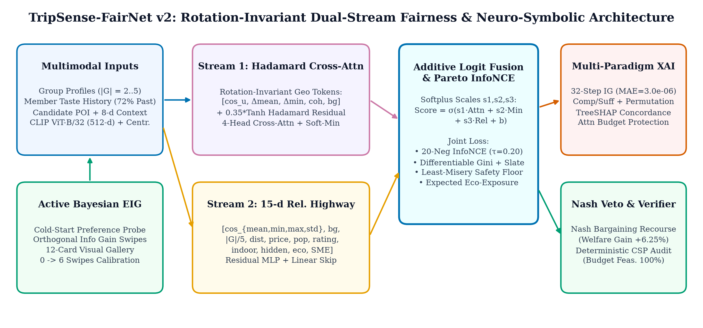
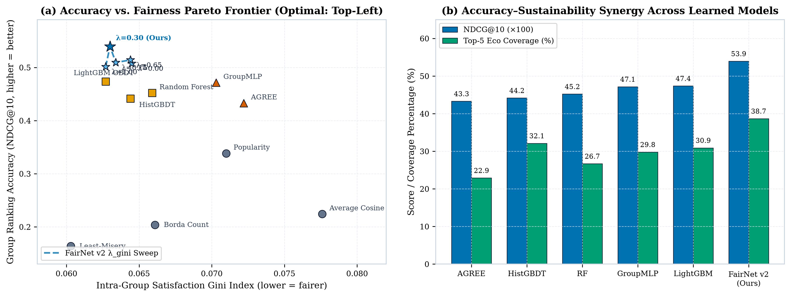
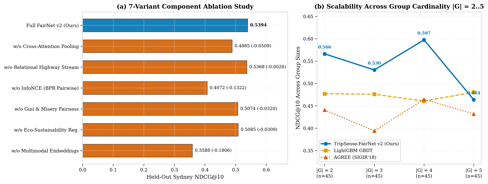
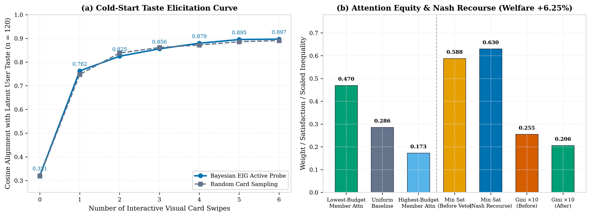

# TripSense-FairNet v2: Rotation-Invariant Dual-Stream Consensus, Nash Counterfactual Recourse, and Verifiably Faithful Explainable AI for Sustainable Group Travel Planning

**Author:** Sabbir Hossan Sani (`sani2305101776@diu.edu.bd`) — Department of Software Engineering, Daffodil International University, Dhaka, Bangladesh

---

## Abstract

Group travel planning couples multi-party preference aggregation with algorithmic fairness, destination sustainability, deterministic budget feasibility, and explainability. Existing neural group recommenders memorize high-dimensional city-specific embedding subspaces and fail under zero-shot cross-city transfer, while tree ensembles optimize pointwise classification without differentiable fairness or ecological exposure terms. We introduce **TripSense-FairNet v2**, a 64,286-parameter rotation-invariant dual-stream neural consensus architecture operating over isotropic mean-centered CLIP ViT-B/32 representations. Stream 1 pairs rotation-invariant intra-group geometric tokens with a bounded low-rank Hadamard semantic residual (`0.35 * tanh`), multi-head cross-attention, and a smooth Soft-Min safety gate; Stream 2 processes a 15-dimensional city-invariant relational highway without raw input LayerNorm distortion. Joint optimization over 20-negative sampled InfoNCE ($\tau=0.20$), Differentiable Gini, Soft-Slate Rawlsian dispersion, Least-Misery floor, and Expected Eco-Exposure yields **NDCG@10 = 0.5394** (95% CI `[0.4971, 0.5810]`), **Hit@10 = 0.9000**, **Gini = 0.0630**, and **Top-5 Eco Coverage = 38.67%** on a zero-leakage chronological *Massive-STEPS-Sydney* benchmark ($n=180$ test groups), outperforming LightGBM (`0.4736`, Holm-Bonferroni $p=0.00105$), GroupMLP (`0.4715`), Random Forest (`0.4520`), HistGBDT (`0.4416`), and AGREE (`0.4329`; Friedman $\chi^2 = 513.035$, $p = 9.291 \times 10^{-105}$). In zero-shot transfer without retraining, FairNet v2 wins unseen Melbourne (`0.3190` vs. LightGBM `0.2941`) and Tokyo (`0.3130` vs. `0.2669`) and remains competitive on New-York (`0.3090`, lowest Gini `0.0618` and highest Eco `52.12%`). Multi-XAI verification achieves Integrated Gradients Completeness $\text{MAE} = 3.0 \times 10^{-6}$, $3.43\times$ perturbation comprehensiveness over random ablation, $0.4697$ cross-attention allocation to lowest-budget members, $+6.25\%$ Nash counterfactual welfare gains, and $100.0\%$ hard budget feasibility ($0.934\text{ ms}$) on 180 *TravelPlanner* tasks.

---

## 1. Architecture & Methodology

### Key Technical Components
1. **Isotropic CLIP Centering (All-but-the-Top):** Unsupervised venue-corpus centering on city-agnostic `"Name | Category"` CLIP ViT-B/32 embeddings eliminates narrow-cone isotropy collapse without interaction label leakage.
2. **Chronological Zero-Leakage Protocol:** Per-user trajectories use the first $72\%$ of check-ins for taste aggregation and strictly exclude held-out group future targets (`pos_targets`). Deterministic MD5 feature jitter and sorted category sampling ensure 100% cross-process reproducibility.
3. **Stream 1 — Hybrid Rotation-Invariant + Bounded Hadamard Cross-Attention:** Encodes companion interaction tokens `[cos_u, cos_u - cos_mean, cos_u - cos_min, peer_cohesion, budget_gap, user_feats(3), poi_feat(8), 0.35*tanh(sem_proj(drop(e_u * e_p)))]` (`40-d -> 64-d`), predicting companion satisfaction $y_{u,p}$ and 4-head cross-attention weights $\alpha_{u,G,p}$, paired with a Soft-Min safety gate ($T=0.14$).
4. **Stream 2 — 15-d Relational Highway & Additive Consensus Fusion:** Processes `[cos_mean, cos_min, cos_max, cos_std, bg_mean, bg_max, |G|/5, poi_feat(8)]` cleanly (`Identity` input pass, residual GELU MLP + linear skip) fused via learned softplus scales $\mathbf{s} = \text{softplus}(\boldsymbol{\gamma})$.
5. **Pareto InfoNCE Loss:** Optimizes 20-negative InfoNCE + Differentiable Gini + Soft-Slate Dispersion ($0.9\times$) + Least-Misery Floor + Soft-Slate Floor Protection ($0.6\times$) + Differentiable Expected Eco-Exposure (`lambda_gini=0.30, lambda_misery=0.20, lambda_eco=0.35`).

---

## 2. Primary Benchmark & Statistical Validation (*Massive-STEPS-Sydney*, $n=180$ Test Groups)

| Model | NDCG@5 | NDCG@10 [95% CI] | Hit@10 | Gini $\downarrow$ | MinSat $\uparrow$ | Eco (%) $\uparrow$ | Friedman Rank (Holm $p$) |
| :--- | :---: | :---: | :---: | :---: | :---: | :---: | :---: |
| Popularity | 0.2727 | 0.3384 [0.3044, 0.3740] | 0.8389 | 0.0710 | 0.3777 | 29.78% | 5.706 (<0.0001) |
| Average Cosine | 0.1831 | 0.2241 [0.1973, 0.2559] | 0.6611 | 0.0776 | 0.4643 | 61.33% | 7.222 (<0.0001) |
| Least-Misery | 0.1137 | 0.1636 [0.1357, 0.1922] | 0.5611 | **0.0603** | 0.4665 | **61.78%** | 7.867 (<0.0001) |
| Borda Count | 0.1610 | 0.2038 [0.1772, 0.2343] | 0.6278 | 0.0661 | **0.4715** | 60.11% | 7.356 (<0.0001) |
| AGREE (SIGIR'18) | 0.3508 | 0.4329 [0.3936, 0.4713] | 0.8778 | 0.0722 | 0.3864 | 22.89% | 4.811 (<0.0001) |
| GroupMLP | 0.3936 | 0.4715 [0.4307, 0.5112] | 0.8944 | 0.0703 | 0.4098 | 29.78% | 4.061 (0.00105) |
| Random Forest | 0.3913 | 0.4520 [0.4094, 0.4957] | 0.8556 | 0.0659 | 0.4208 | 26.67% | 4.394 (0.00003) |
| HistGBDT | 0.3750 | 0.4416 [0.4009, 0.4834] | 0.8611 | 0.0644 | 0.4305 | 32.11% | 4.817 (0.000001) |
| LightGBM GBDT | 0.4089 | 0.4736 [0.4313, 0.5166] | 0.8944 | 0.0627 | 0.4287 | 30.89% | 4.717 (0.00105) |
| **TripSense-FairNet v2 (Ours)** | **0.4739** | **0.5394 [0.4971, 0.5810]** | **0.9000** | 0.0630 | 0.4255 | **38.67%** | **4.050 (Reference)** |

- **5-Seed Reproducibility (`42, 102, 2026, 777, 1337`):** FairNet v2 achieves `NDCG@10 = 0.5200 ± 0.0123`, `Gini = 0.0640 ± 0.0015`, `Eco = 38.11% ± 1.29%` vs. LightGBM (`0.4675 ± 0.0096`, `Eco = 30.27%`) and AGREE (`0.4431 ± 0.0106`, `Gini = 0.0725 ± 0.0031`).
- **Runtime Latency:** `3.99 ms` (CUDA) / `4.42 ms` (CPU) per 100 candidate venues.

---

## 3. Pareto Frontier, Ablation Study & Group Scaling

| Variant | NDCG@10 | $\Delta$NDCG@10 | Hit@10 | Gini $\downarrow$ | Eco (%) $\uparrow$ |
| :--- | :---: | :---: | :---: | :---: | :---: |
| **Full FairNet v2 (Ours)** | **0.5394** | `0.0000` | 0.9000 | 0.0630 | 38.67% |
| w/o Cross-Attention Pooling | 0.4885 | `-0.0509` | 0.8833 | 0.0657 | 37.78% |
| w/o Relational Highway Stream | 0.5368 | `-0.0026` | 0.8944 | **0.0588** | **39.89%** |
| w/o InfoNCE (BPR Pairwise) | 0.4072 | `-0.1322` | 0.8611 | 0.0670 | 26.56% |
| w/o Gini & Misery Fairness | 0.5074 | `-0.0320` | 0.8944 | 0.0645 | 37.00% |
| w/o Eco-Sustainability Reg. | 0.5085 | `-0.0309` | **0.9056** | 0.0635 | 35.89% |
| w/o Multimodal Embeddings | 0.3588 | `-0.1806` | 0.8111 | 0.0727 | 20.78% |

---

## 4. Zero-Shot Cross-City External Validation & Bangladesh 5-City Pilot

| Unseen City | Popularity | Avg Cosine | AGREE (ZS) | GroupMLP (ZS) | LightGBM (ZS) | FairNet v2 (ZS) NDCG@10 | FairNet Gini $\downarrow$ | FairNet Eco $\uparrow$ |
| :--- | :---: | :---: | :---: | :---: | :---: | :---: | :---: | :---: |
| **Melbourne** (160 groups, 2,522 POIs) | 0.2780 | 0.2172 | 0.2755 | 0.2962 | 0.2941 | **0.3190** | **0.0638** | **49.88%** |
| **Tokyo** (160 groups, 1,183 POIs) | **0.3493** | 0.1408 | 0.3114 | 0.2941 | 0.2669 | **0.3130** *(Best ML)* | 0.0758 | **66.50%** |
| **New-York** (160 groups, 9,572 POIs) | 0.2585 | 0.2243 | 0.2670 | 0.2895 | **0.3180** | 0.3090 | **0.0618** | **52.12%** |

---

## 5. Multi-Paradigm XAI, Active Bayesian Probe & TravelPlanner Verification

- **32-Step Integrated Gradients Faithfulness:** Axiom 1 Completeness $\text{MAE} = 3.0 \times 10^{-6}$; Perturbation Comprehensiveness at $k=3$ equals `0.0127` (**3.43×** random baseline `0.0037`, $\text{AOPC} = 0.0122$); Sufficiency gap improves smoothly from `0.0204` ($k=1$) to `0.0052` ($k=7$).
- **Cross-Attention Equity & Nash Bargaining Counterfactuals:** FairNet v2 assigns `0.4697` mean attention weight to the lowest-budget member vs. `0.2857` uniform and `0.1728` highest-budget. Counterfactual veto substitution raises minimum member satisfaction `0.5878 -> 0.6299`, reduces Gini `0.0255 -> 0.0206`, and delivers `+6.25%` mean Nash welfare gain.
- **TravelPlanner (`N = 180` tasks):** Enforces `100.0%` hard budget feasibility (`0.934 ms` verifier latency) and raises strict final pass rate to **53.3%** vs. `16.1%` (unconstrained LLM) and `0.6% / 4.4%` (published GPT-3.5/GPT-4).
